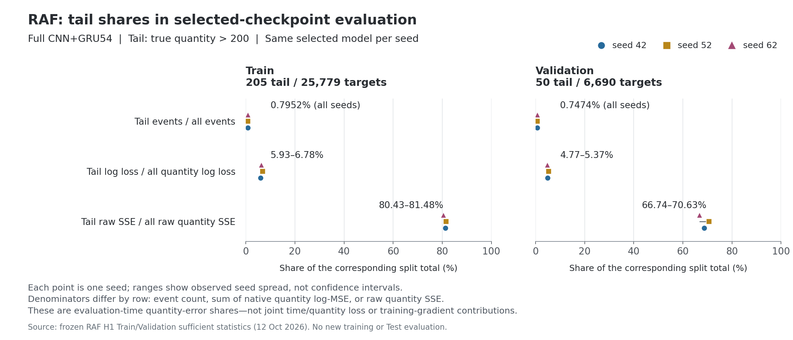

# 저장 모델 진단을 논문 주장과 후속 작업에 연결

현재 상태: RAF18과 Intermittent18의 총36개 모델·split 평가, 원래 지표 재현·실제 종료·원본 SHA·분석·독립 QA가 모두 완료됐다. 새 학습·Test 평가·calibration fit은0이며 열린 main.tex는 수정하지 않았다.

**같은 선택 모델의 효과와 실패 조건을 분리한다 — 완료 / RAF 현재 기준선**

- RAF의 선택9checkpoint를 Train·Validation에서18회 평가했다. 과학 source129·checkpoint·전처리·원래 eval forward는 유지했고 실제 per-target log1p 제곱오차와 raw 오차를 같은 사건에서 연결했다. 학습·Test·모델 재선택은0이다.
- Train full의 전체 log MSE는0.623400으로 직전 수량0.886581·과거 평균0.750893보다 좋다. 큰 수량에서는 log MSE4.952669·raw RMSE463.119714가 직전 수량4.595775/426.561830·과거 평균3.293058/412.177460보다 세 seed 모두 나쁘다. 전체 이득을 큰 수량의 성공으로 바꾸지 않는다.
- Train 큰 수량205/25779건은0.7952%이며 선택 full 모델의 수량 log 손실5.93–6.78%·raw 수량 SSE80.43–81.48%를 차지한다. 이는 평가 상태의 충분통계이며 joint loss 전체나 학습 gradient의 비중이 아니다.
- Validation full의 전체 RMSE 평균34.171127은 두 대조 평균34.296418/34.310911보다 낮지만 seed52에서는 모두 나쁘다. 큰 수량 RMSE327.623692는 두 대조324.787004/323.612248보다 높다. 큰 수량에서 직전 수량보다 log MSE는 좋고 raw RMSE는 나쁘며, 평균 기준선보다 두 오류 모두 나쁘다.
- 같은 부분집합에서 로그·raw 방향이 엇갈린 관측과 전체/큰 수량의 서로 다른 모집단 요약을 구분한다. 원래 checkpoint 선택은 전체 raw RMSE이며 평균 학습 log loss를 최적화한 최종 상태나 Test 선택으로 바꾸지 않는다.
- 원본 분석: [RAF log/raw 보고서](../../search_artifacts/titantpp_raf_log_raw_20261012_v2/analysis/RAF_LOG_RAW_REPORT.md), [독립 최종 QA](../titantpp_raf_log_raw_20261012_v2/FINAL_QA.md).

**실행 전 검증 오류를 과학 결과와 구분한다 — 완료**

- RAF v1은 합성 CUDA의 eval RNN backward 제약으로 첫 native route에서 exit1이었다. 실제 선택 모델 평가는0개였고 claim·봉인·실패 원문을 보존했다. v2는 합성 gradient fixture만 ATen으로 잠시 검증하고 복원했다. 실제 저장 모델 평가와 원래 cuDNN eval forward는 변경하지 않았다.
- v2의 실제18worker·pipeline OS exit0와357개 원본의 archive·manifest·두 로컬 복사본 SHA·독립 QA가 확인됐다. Intermittent 계약은 이 v2 완료·원본·분석·정확한 QA PASS 판정 원문을 선행 조건으로 봉인했다.
- 개별 예측·목표·시간 head 배열은 디스크에 남기지 않았다. 원고 main.tex, 공유 Runtime·driver·인증·기존 원본·자동화는 변경하지 않았다.

**시간 위치와 폭의 점수 의존성을 확인한다 — 완료 / Intermittent 현재 기준선**

- Intermittent9모델×Train/Validation=18pass를 seed×split의 실제6joint 작업에서 수행한다. joint 작업은1개씩, resident 모델은3개다. 원래 두 모델의 정수 확률질량 점수를 먼저 재현하고 실제 event의 위치만·폭만 교체한 점수와 상호작용을 비교한다.
- 6pair×2split×4=48 paired score cells 중 새 교차셀은24개다. 전체와 Train에서 고정한 시간 구간을 모두 포함한다. 임의 floor·temperature·offset·grid·calibration fit·Test fit은0이다.
- 이 점수는 서로 다른 저장 모델 출력을 섞은 의존성 관측이다. 새 단일 모델의 성과, CNN/GRU 학습의 인과 원인, 기존 Test 반전의 해결이나 새 일반화 확인으로 주장하지 않는다.

**시간 교차 점수의 실제 방향과 반례를 기록한다 — 완료**

- Validation6조건 모두 σ만 교체하면 개선, μ만 교체하면 손해였다. Train에서는 두 단일 교체 모두6조건에서 손해였다. Validation seed42는 full0.618713→대조 σ 교체0.243837/0.253718, 대조 μ 교체0.858383/0.686191이다.
- 3seed 전체 Validation NLL 평균은 full0.409740, full μ+제거 σ0.243500, full μ+current-only σ0.253584다. Train 평균은 full0.217038, 같은 σ 교체0.228578/0.224387로 높아졌다. 평균·표본 SD·원래 두 대조·상호작용·모든 구간을 원본에 보존했다.
- Validation의 σ 교체 개선은 기록된 간격(1,3]에서 두드러졌다. ≤1 구간은6조건 모두 σ 교체 손해였고 일부 >7 구간에도 손해가 있었다. 모든 시간대에서 폭을 바꾸면 좋아진다고 설명하지 않는다.
- full의 시간 위치를 유지한 상태에서 조건부 분포 폭의 평가 구간 취약성을 점검할 근거다. 어느 head를 학습해야 하는지, σ floor 문제인지, σ를 일괄 확대하면 좋아지는지는 미확정이다. 서로 다른 모델의 위치·폭을 섞은 점수이고, 기존 Test의 반전이나 독립 일반화 확인을 해결한 것이 아니다.
- [시간 위치·폭 원본 보고서](../../search_artifacts/titantpp_intermittent_time_cross_20261012_v1/analysis/TIME_CROSS_REPORT.md), [독립 최종 QA](FINAL_QA.md)를 직접 근거로 사용한다.

**큰 수량의 평가 비중을 시각화한다 — 완료**

같은 선택 full의3seed 관측점이며 각 행의 분모는 전체 사건 수·수량 log 손실합·raw 수량 SSE다. 평가 시점 수량 오류 비중으로 학습 gradient 비중을 뜻하지 않는다. [비중 계산과 원본 SHA](../titantpp_raf_log_raw_20261012_v2/figures/figure_receipt.json).

**다음 작업을 제한된 주장에 맞춰 정한다 — 다음 작업 / 전체36 분석 확정 후**

- 첫 순서는 같은 열린 main.tex에 완료 결과와 예외를 반영하는 문서 작업이다. 현재 mean prototype 설명과 결합 보정 경로의 조건부 효과를 유지하고 RAF 큰 수량·seed 예외와 시간 손해를 공개한다. 이번 실행에서는 main.tex를 편집하지 않았다.
- 새 학습은 자동 실행하지 않는다. 수량 목표 변경이 큰 수량 오류를 개선하는지 확인해야 한다면 RAF full×기존/변경 수량 목표×3seed=6fresh의 새 공통 계약이 최소 비교 후보다. 과거 다른 GPU full3을 새 변경3과 matched6으로 합치지 않는다. 가중치·학습·선택·완료 기준을 Train/Validation에서 사전 고정하고 별도 실행 승인을 받아야 한다.
- 시간 교차 점수만으로 새 calibration을 승인하거나 최적 값을 선택하지 않는다. 실제 시간 head를 fit해야 하는 질문이 남으면 H2의 위치/폭/상호작용 결과에 맞춰 단일 가설·Train fit·Validation 확인·모델 동결 계약을 따로 작성한다.
- 설계 추가 또는 생략을 결정하고 모델·전처리·대조·지표를 동결한 뒤 미노출 확인을 정한다. 현재 사용했던 Test와 이번 Train/Validation 진단을 새 독립 확인으로 부르지 않는다. 전체 CPU binary 재추론 감사는 별도 미완료다.
- Related Work·References·Appendix와 실제 투고 규정 점검은 최종 주장에 맞춰 이어간다. 독립 문헌·증적 점검은 병렬 가능하며 공통 원고·GPU·선택 기준선은 직렬로 진행한다.
